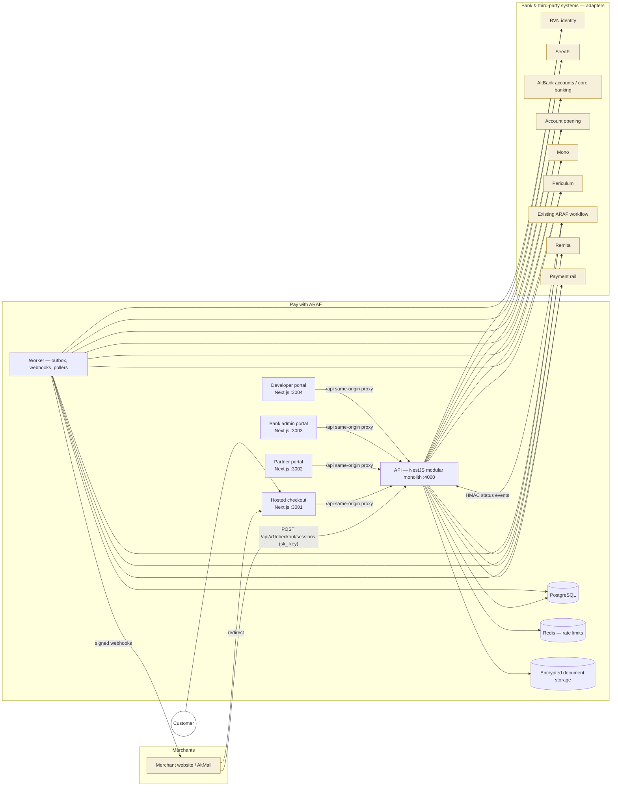
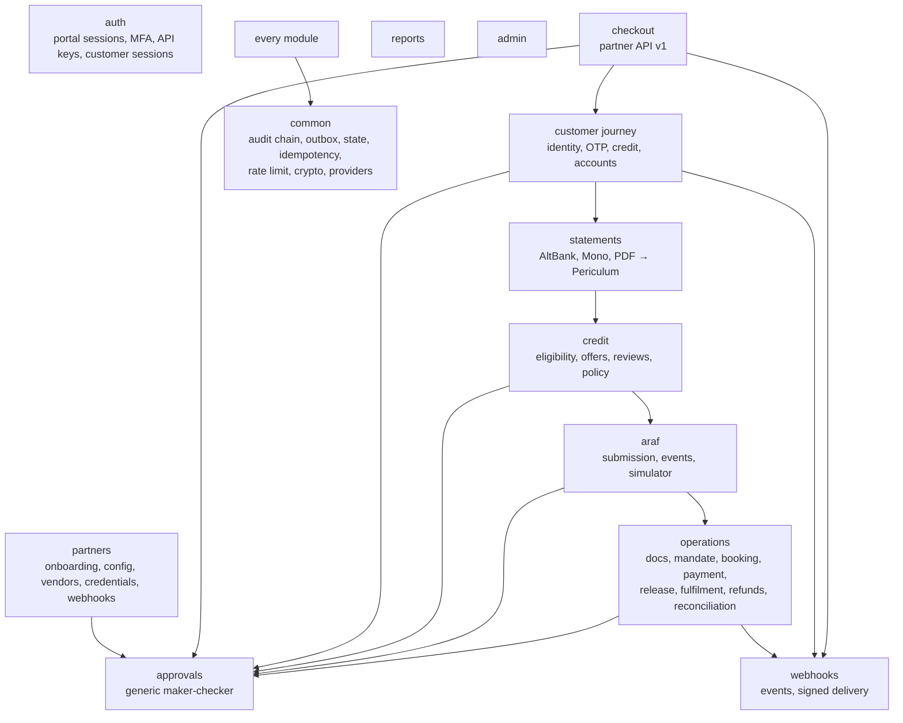
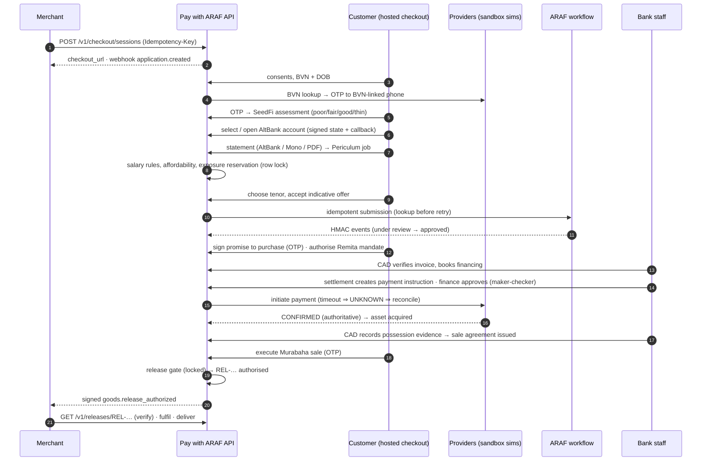

# Architecture

## 1. System context

AltMall integrates exactly like any external merchant (public API + signed webhooks) and has its
own database; it has no access to the financing database.

## 2. Monorepo

| Path | Purpose |
| --- | --- |
| `apps/api` | NestJS API (HTTP entry `main.ts`) and worker (entry `worker.ts`, same codebase) |
| `apps/customer-checkout` | Hosted, mobile-first financing journey + sandbox provider stand-in pages |
| `apps/partner-portal` | Merchant dashboard |
| `apps/admin-portal` | Bank administration, credit review, ARAF simulator, operations |
| `apps/developer-portal` | Docs, API explorer, webhook verifier |
| `apps/altmall-demo` | Demonstration storefront (external merchant) |
| `packages/business-rules` | Pure deterministic financial rules + state machines |
| `packages/security` | Crypto, keys, OTP/TOTP, webhook signatures, SSRF guard, privacy helpers |
| `packages/database` | Prisma schema, migrations, seed |
| `packages/integrations` | Adapter interfaces, sandbox simulators, fail-closed live adapters, storage |
| `packages/types` | RBAC catalogue, webhook events, error catalogue, public request schemas |
| `packages/ui`, `packages/design-tokens` | Design system |

## 3. API modules

Cross-cutting guarantees:
* **Global deny-by-default guard** — every route must declare `@Public`, `@Staff(perm…)`,
  `@PartnerUser(perm…)`, `@ApiKey(scope)` or `@Customer()`; undecorated routes are refused.
* **Tenant scoping** — partner-facing queries always filter by `partnerId` from the credential or
  session (never from request input) **and** `environment`.
* **State transitions** — `StateService.transitionApplication` validates against the state machine,
  uses optimistic concurrency (`version`), writes immutable history and an outbox event in the
  same transaction. Critical sections additionally `SELECT … FOR UPDATE` the application row.
* **Audit** — `AuditService` appends hash-chained records (canonical JSON, advisory-lock
  serialised); a DB trigger makes `audit_logs`, state history and payment events append-only.

## 4. End-to-end lifecycle

## 5. Data model (key entities)

Identity & access: `users`, `roles`, `permissions`, `user_roles`, `sessions`, `mfa_credentials`,
`user_invitations`, `approval_requests`. Partners: `partners`, `partner_configurations` (versioned),
`partner_domains`, `partner_api_credentials`, `partner_webhook_endpoints`, `vendors`,
`vendor_settlement_accounts`. Journey: `customers`, `customer_accounts`, `customer_consents`,
`checkout_sessions`, `customer_sessions`, `merchant_orders`, `order_items`,
`financing_applications`, `application_state_history`, `identity_verifications`, `otp_challenges`.
Credit: `credit_policies`, `credit_policy_versions`, `credit_assessments`, `enhanced_reviews`,
`review_decisions`, `affordability_assessments`, `exposure_reservations`. Statements:
`account_opening_requests`, `stored_documents`, `statement_connections`,
`statement_analysis_jobs`, `statement_analysis_results`. Offers: `financing_offers`,
`repayment_schedules`, `offer_acceptances`. ARAF & ops: `araf_submissions`, `araf_status_events`,
`contractual_conditions`, `financing_documents`, `repayment_mandates`, `booking_records`,
`vendor_payment_instructions`, `vendor_payment_events`, `reconciliation_runs`,
`payment_reconciliations`, `release_authorizations`, `fulfilment_records`,
`cancellation_requests`, `return_requests`, `refund_records`. Platform: `outbox_events`,
`webhook_events`, `webhook_deliveries`, `webhook_delivery_attempts`, `idempotency_records`,
`notifications`, `notification_templates`, `audit_logs`, `integration_logs`, `api_request_logs`,
`operational_exceptions`, `reference_sequences`. Sandbox-only: `sim_araf_cases`,
`sim_araf_actions`, `sim_records`, `sandbox_messages`.

Integrity controls (migration `integrity_controls`): append-only triggers; one live vendor payment
per application (partial unique index); one accepted offer per application; one active policy and
partner configuration; CHECK constraints for amounts (incl. `financing + contribution = purchase`,
`DSP = financing + profit`, `line = unit × qty`); maker ≠ checker CHECKs.

## 6. Data flows & classification

| Class | Examples | Controls |
| --- | --- | --- |
| Restricted | BVN, DOB, phone, account numbers, statements, salary credits, review forms, TOTP secrets | AES-256-GCM + AAD, blind index for BVN lookup, masked display, never logged, sensitive-permission gated, access audited |
| Confidential | Scores, affordability, decisions, payment details | Bank roles only; never in partner views or webhooks |
| Internal | Application status, references, amounts | Tenant-scoped |
| Secret | API keys (hashed), webhook secrets (encrypted), session tokens (hashed), OTPs (HMAC) | Shown once / never stored in plaintext |

## 7. Deployment topology
Stateless API replicas behind the Bank's API gateway/WAF; ≥ 2 worker replicas (SKIP LOCKED);
managed PostgreSQL with PITR; Redis; S3-compatible encrypted object storage; KMS/HSM-managed data
keys; OpenTelemetry collector. See `DEPLOYMENT.md`.

## 8. Future AltPay integration
Pay with ARAF exposes a payment-method-agnostic contract (checkout session → hosted journey →
status API → events). AltPay can list "Pay with ARAF" as a payment method by creating checkout
sessions on the merchant's behalf and relaying events; the financing engine is unchanged.
